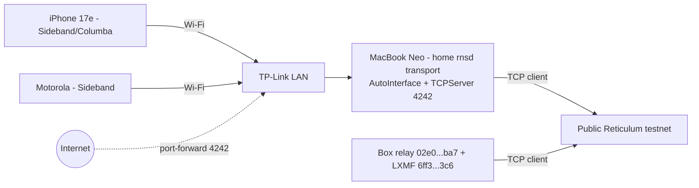

# ЯLAB BRIDGE-LANDING (Reticulum)
A "landing" is the piece of the bridge left on each device/place so it can join the ЯLAB Reticulum mesh.
No secrets or private keys are in this kit. Each device makes its own identity on first run.

- Box relay transport ID: `02e065917c3473c7682fe60250b59ba7`
- LXMF propagation node: `6ff3999dad3a9a9a6d911d292bbd23c6`
- Box relay TCP 4242 is NOT publicly reachable. The box joins through the public testnet.

## Topology

## Files
- landing-17e.md / landing-moto.md: phone app settings
- landing-neo/: config template, install.sh (venv), launchd plist template. Nothing runs automatically.
- landing-tplink.md: router steps (model TBD)
- node.json: RKLOWD-style node manifest

## Where to drop copies
ЯLAB shared folder (`~/R/ЯLAB/RKLOWD/nodes/BRIDGE-LANDING/`, which also shows in the 17e Files app), GitHub repo, website `/bridge/`.
